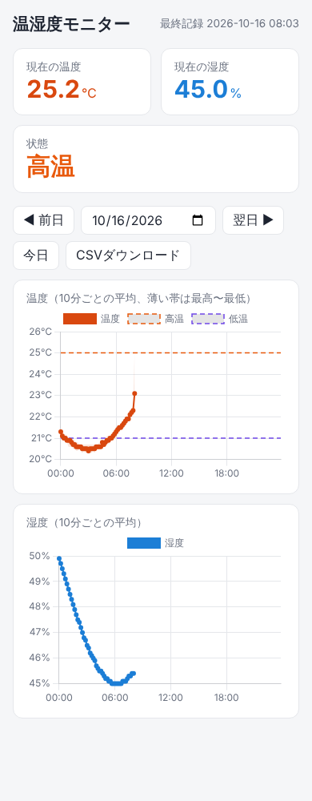

# 温湿度モニター

Raspberry Pi と温湿度センサー SHT31 で、温度・湿度を1分ごとに記録し、Webサイトで確認できるようにする試作システム。

**公開サイト：https://omoti12.github.io/temp-humidity-monitor/**



## できること

- 1分ごとに温度・湿度を測ってSDカードにCSVで保存（日付ごとに1ファイル）
- 30℃以上で【高温警報】、21℃以下で【低温警報】のメールを送信（正常に戻ったら【回復】メール、異常が続けば60分ごとに再通知）
- Webサイトで現在の温度・湿度・状態と、10分ごとのグラフを表示（スマホ対応）
  - GitHub Pages：どこからでも見られる。グラフは10分ごと、現在値は5秒ごと（ラズパイから直接読む）
  - ラズパイ内のサイト（`http://ラズパイのIP:8000`）：同じネットワーク内から。1分ごとに更新
- 10分ごとにグラフ画像（PNG）を作成。ラズパイにつないだモニターで表示できる
- 1時間ごとに記録をGoogleドライブへバックアップ

```
センサー ─▶ ラズパイ（1分ごとに記録・警報メール）
              ├─ 10分ごと ─▶ GitHub Pages（どこからでも閲覧）
              ├─ 現在値 ─▶ Tailscale Funnel（/api/now だけ公開）─▶ GitHub Pages の画面
              └─ 1時間ごと ─▶ Googleドライブ（バックアップ）
```

## 構成

| ファイル | 内容 |
|---|---|
| `sht31_logger.py` | 測定・CSV記録・警報メール |
| `sht31_graph.py` | グラフ画像（PNG）の作成 |
| `pages/` | GitHub Pages 用のサイトと公開スクリプト |
| `web/` | ラズパイ内で動くサイト（Flask） |
| `systemd/` | 自動起動・定期実行の設定 |

記録先は `/home/iot-user/templog/`（SDカード）。
現在値 `now.json` とグラフ画像 `graph.png` は `/dev/shm/temp-monitor/`（メモリ上。再起動で消え、すぐ作り直される）。プログラムは `/home/iot-user/temp-monitor/`（このリポジトリ）から直接動かす。

## 必要なもの

- Raspberry Pi（ネット接続できること）
- 温湿度センサー Adafruit SHT31-D（I2Cアドレス 0x45 で使用。ADDRピン未接続なら `sht31_logger.py` の `ADDR` を 0x44 に変更）
- microSDカード（高耐久タイプ推奨）

## セットアップ

ユーザー名は `iot-user` 前提。違う場合は、各ファイルの `/home/iot-user` と `User=iot-user` を書き換える。

### 1. GitHub の準備（PCで）

- リポジトリを **Public** にする（Settings → General → 一番下の Danger Zone → Change visibility）
  ※ 無料プランで GitHub Pages を使うため。サイトはURLを知っている人なら誰でも見られる

### 2. インストール（ラズパイで）

```
sudo apt install git python3-smbus2 python3-matplotlib python3-flask fonts-noto-cjk rclone
git clone https://github.com/omoti12/temp-humidity-monitor.git /home/iot-user/temp-monitor
```

I2Cを有効にしておく（`sudo raspi-config` → Interface Options → I2C）。

### 3. 自動起動の設定ファイルを入れる

```
sudo cp /home/iot-user/temp-monitor/systemd/* /etc/systemd/system/
```

パスワードは **コピーした先（/etc/systemd/system）** で書き換える。リポジトリ内のファイルには書かないこと。

```
sudo nano /etc/systemd/system/temp-web.service       # ラズパイ内サイトにパスワードをかけるとき
```

警報メールを使うときは、設定ファイルを作って送信元・アプリパスワード・宛先を書く：

```
mkdir -p ~/.config/temp-monitor
cp ~/temp-monitor/mail.env.example ~/.config/temp-monitor/mail.env
chmod 600 ~/.config/temp-monitor/mail.env     # 自分だけが読めるようにする
nano ~/.config/temp-monitor/mail.env
python3 ~/temp-monitor/sht31_logger.py --test-mail   # テストメールを送る
sudo systemctl restart sht31-logger
```

Gmailの場合は、Googleアカウントで2段階認証をオンにして「アプリパスワード」を作り、それを使う。

### 4. 記録・警報・グラフを開始

```
sudo systemctl daemon-reload
sudo systemctl enable --now sht31-logger temp-web sht31-graph.timer
```

### 5. GitHub Pages で公開する

ラズパイがGitHubに書き込むための鍵を作る：

```
ssh-keygen -t ed25519 -N "" -f ~/.ssh/id_ed25519
cat ~/.ssh/id_ed25519.pub
```

表示された1行（`ssh-ed25519 ...`）をコピーし、GitHubのリポジトリの
Settings → Deploy keys → Add deploy key に貼り付ける。**「Allow write access」にチェックを入れる。**

1回だけ手動で公開してみる（初回は `yes` と聞かれたら `yes`）：

```
ssh -T git@github.com
python3 /home/iot-user/temp-monitor/pages/publish.py
```

「公開しました」と出たら、GitHubの Settings → Pages で
Source を「Deploy from a branch」、Branch を `gh-pages` / `/(root)` にして Save。
数分後に https://omoti12.github.io/temp-humidity-monitor/ で見られる。

10分ごとの自動公開を開始：

```
sudo systemctl enable --now pages-publish.timer
```

### 6. 現在値をリアルタイムで見られるようにする（Tailscale Funnel）

GitHub Pages は更新回数に制限があるので、現在値だけはラズパイから直接読む。
ラズパイ内サイトを起動し、その中の `/api/now`（現在値）だけをインターネットに公開する。

```
sudo systemctl enable --now temp-web
curl -fsSL https://tailscale.com/install.sh | sh
sudo tailscale up                 # 表示されたURLを開いてログイン
sudo tailscale funnel --bg --set-path /api/now http://127.0.0.1:8000/api/now
```

最後のコマンドで有効化のURLが表示されたら、開いて許可する。
表示された `https://〜.ts.net/api/now` をブラウザで開き、現在値が出れば成功。
そのURLを `pages/index.html` の `NOW_URL` に書いて push し、ラズパイで `git pull` すると、次の公開（10分以内）からサイトの現在値がリアルタイムになる。

### 7. Googleドライブへのバックアップ

```
rclone config        # n → 名前 gdrive → 種類 drive → あとはEnter
sudo systemctl enable --now templog-backup.timer
rclone ls gdrive:温湿度記録   # CSVが並べば成功
```

## 更新するとき

```
cd /home/iot-user/temp-monitor && git pull
sudo systemctl restart sht31-logger temp-web
```

## 確認方法

```
systemctl status sht31-logger           # 記録の動作状況
tail -f /home/iot-user/templog/*.csv           # 記録の中身
journalctl -u sht31-logger -f            # 警報メールの送信ログ
journalctl -u pages-publish -n 20        # GitHub Pages への公開ログ
systemctl list-timers                    # 定期実行の予定
```

## 長く動かすために

SDカードは書き込み回数で消耗するので、書き込みを減らしている。

| データ | 場所 | 書き込み |
|---|---|---|
| 記録（CSV） | SDカード | 1分に1行追記 |
| 現在値（5秒ごと）・グラフ画像（10分ごと） | メモリ（`/dev/shm`） | SDカードには書かない |
| 公開用の作業データ | SDカード | 10分ごと。古い版は毎日3時台に自動で掃除 |

ほかに効果が大きいもの：

- **Googleドライブへのバックアップ**（手順7）：SDカードが壊れても記録が残る
- **UPS（停電対策）**：電源が急に切れるとSDカードが壊れることがある
- **高耐久のSDカード**を使う

止まりにくくする・止まったときに原因を追えるようにする設定（ラズパイで1回だけ）：

```
# Wi-Fiの省電力モードを切る（Wi-Fiが切れて外から見えなくなるのを防ぐ）
printf '[connection]\nwifi.powersave = 2\n' | sudo tee /etc/NetworkManager/conf.d/wifi-powersave-off.conf
sudo systemctl restart NetworkManager

# 動作ログを再起動後も残す（最大50MB）。止まる直前のログは journalctl -b -1 で見られる
sudo mkdir -p /etc/systemd/journald.conf.d /var/log/journal
printf '[Journal]\nStorage=persistent\nSystemMaxUse=50M\n' | sudo tee /etc/systemd/journald.conf.d/persistent.conf
sudo systemctl restart systemd-journald
```

電源アダプタはラズパイ5用の 5V 5A（27W）を使う。力不足だと負荷がかかったときに止まる
（`vcgencmd get_throttled` が `throttled=0x0` 以外なら電圧不足が起きている）。

ラズパイにつないだモニターにグラフ画像を出し続けるとき：
`feh --fullscreen --reload 60 /dev/shm/temp-monitor/graph.png`

## 設定値

| 項目 | 値 | 場所 |
|---|---|---|
| 記録・警報判定の間隔 | 60秒 | `sht31_logger.py` の `INTERVAL` |
| 現在値の更新間隔 | 5秒 | `sht31_logger.py` の `NOW_INTERVAL` |
| 高温警報 | 30℃以上 | `TEMP_HIGH`（`sht31_logger.py` `sht31_graph.py` `web/app.py` `pages/publish.py` で同じ値にする） |
| 低温警報 | 21℃以下 | `TEMP_LOW`（同上） |
| 回復と判断する幅 | 0.5℃ | `sht31_logger.py` の `HYSTERESIS` |
| 再通知の間隔 | 60分 | `sht31_logger.py` の `REMIND_MIN` |
| グラフの間隔 | 10分 | `STEP_MIN` |

## ライセンス

`web/static/chart.umd.js` は [Chart.js](https://www.chartjs.org/)（MIT License、`web/static/chart.js-LICENSE.md`）。
